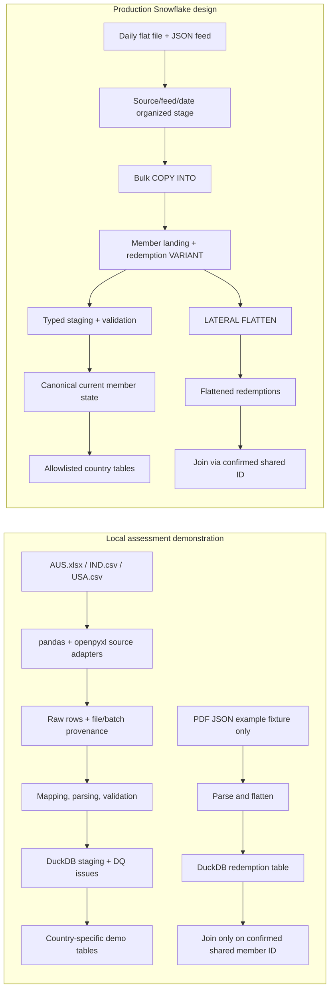

# SkyPoints assessment architecture

## 1. Requirements, scope, and acceptance

The design covers the six assessment deliverables in [assessment-requirements.md](assessment-requirements.md): landing/staging/country-target DDL; Age and stale derivation; country distribution; flattened redemption transactions and join; data validation; and a live demonstration.

The local implementation is a reproducible demonstration for the three active inputs (`AUS.xlsx`, `IND.csv`, `USA.csv`) using Python, pandas/openpyxl, DuckDB, and pytest. Snowflake DDL and SQL describe the production-oriented implementation. The local sample does not prove throughput at billions of rows per day.

Acceptance for the later implementation: original input files remain byte-for-byte untouched; every input row is accounted for as accepted, warned, or quarantined; invalid values remain traceable; local results are reproducible for a fixed `as_of_date`; country routing shows its provenance; all tests pass locally and in GitHub Actions; and SQL artifacts map to the assessment deliverables. No production cloud deployment is required.

Out of scope: business rules not present in the assessment or approved by the source owner, global identity creation, member-update timestamps fabricated from operational metadata, source data correction, Docker or additional orchestration/compute infrastructure, and production deployment.

## 2. System architecture and data flow



Local responsibilities: pandas/openpyxl read the three source formats without changing them; source adapters retain raw values; validation returns provenance-linked outcomes; transformations derive age/staleness and apply the isolated filename sample router; the DuckDB persistence module stores run/artifact lineage, raw member and redemption inputs, per-run outcomes/issues, reconciliation, and curated views; pytest exercises results. There is not yet a CLI that orchestrates the complete run. The PDF JSON is a test fixture, not an actual raw input.

Production responsibilities: object storage holds immutable delivered files; Snowflake stages and bulk-loads the described delimited member and JSON feeds; raw tables retain landed values and metadata; SQL staging validates and standardizes; a central canonical table is the source of truth once identity and order fields exist; physical country target tables satisfy the DDL deliverable; JSON `VARIANT` is flattened into one row per transaction.

Snowflake supports delimited text and JSON formats, but its listed load formats do not include XLSX. Local workbook ingestion therefore remains in Python; any production XLSX delivery would require an approved preprocessing conversion while retaining the original. [Snowflake file-format reference](https://docs.snowflake.com/en/sql-reference/sql/create-file-format) Snowflake `LATERAL FLATTEN` turns nested arrays in `VARIANT` into relational rows. [Snowflake FLATTEN reference](https://docs.snowflake.com/en/sql-reference/functions/flatten)

## 3. Ingestion, raw landing, file naming, and dates

### Active inputs and raw preservation

The active inventory is exactly `AUS.xlsx`, `IND.csv`, and `USA.csv`. The two duplicate format variants have already been removed; do not add adapter aliases or load mappings for them. Keep original names and bytes unchanged. Local landing stores source file, optional sheet, data-row number, source code, content hash, schema fingerprint, raw row/value representation, and routing method. The PDF JSON remains under `tests/fixtures/` only if later needed for tests, clearly marked as illustrative.

The PDF describes a production pipe-delimited member file with `H`/`D` records and a nested JSON redemption feed. Snowflake landing preserves the raw member record plus source metadata and stores redemption payloads as `VARIANT`. Retain unknown/extra source fields and a source-column-presence map so an absent field is distinguishable from a present field with a null marker.

### Proposed batch filename convention

For staged batch copies (not renaming the received file), propose:

```text
<feed>_<source>_<ingested_at_utc>_<sha256_prefix>.<extension>
```

Example: `member_AUS_20261124T153000Z_a1b2c3d4e5f6.xlsx`. `<feed>` is `member` or `redemption`; `<source>` comes from an approved source manifest (the local member source codes are `AUS`, `IND`, and `USA`); the hash prefix is derived from file contents. Store the exact original filename separately. Reuse the manifest entry on retries; use content hash and batch ledger for idempotency, not the operational timestamp.

Generate `ingested_at_utc` as a timezone-aware UTC operational timestamp and serialize the filename timestamp with `Z`. Use UTC-aware timestamps locally and UTC `TIMESTAMP_TZ` in Snowflake. This timestamp says when ingestion occurred; it is not a member update/effective time.

### Explicit date adapter formats

| Adapter | Accepted representation | Observed issue / rule |
|---|---|---|
| `AUS.xlsx` | Native Excel date cells. Text fallback is `YYYY-MM-DD`, based on displayed workbook format. | Treat literal `NULL` as a missing DOB marker. Reject invalid calendar text such as `2021-13-13`; preserve raw value. |
| `IND.csv` | `M/D/YYYY` (`%m/%d/%Y`). | This parses the observed rows, but locale/format is not declared by the source; record as an adapter assumption. |
| `USA.csv` | Compact 7- or 8-digit month/day/year candidates with a four-digit year. Seven-digit values allow 1- or 2-digit month and day widths (the widths sum to 3); eight-digit values use two digits for each. | Enumerate all calendar-valid splits and accept only a unique parse. `1052022` is either `1/05/2022` or `10/5/2022`; `1152022` is either `1/15/2022` or `11/5/2022`. Preserve both raw strings and leave them unparsed. |

These are implementation parse rules, not assertions that the source owner has supplied a formal date contract. The PDF's flat-file examples suggest `YYYYMMDD` for enrollment/flight and `MMDDYYYY` for DOB, but the PDF does not specify these field formats as a contract. Keep that distinction explicit.

The PDF gives `HHMMSSTT` as an example filename time but does not define `TT`, the timezone, or whether the timestamp is source extraction time. Ask the source owner to define those details. The proposed staged filename instead uses an explicit UTC ingestion timestamp; never interpret it as source business recency. The current three source files have no time-zone fields. Date-only values are treated as calendar dates, not timestamps.

## 4. Canonical model and mapping

The canonical staged observation has `source_code`, `source_file`, nullable `source_sheet`, `source_row_number`, `batch_id`, `source_content_hash`, `source_schema_fingerprint`, `source_columns_present`, `ingested_at_utc`, `country_routing_method`, and raw source values. This provenance distinguishes absent columns from present nulls and supports reconstruction from the untouched raw file.

| Canonical field | AUS.xlsx | IND.csv | USA.csv | Notes |
|---|---|---|---|---|
| `source_member_id` | `Unique ID` | `ID` | `ID` | String form; local to source, not global. |
| `member_name` | `Member Name` | `Name` | `Name` | PDF `Member_Name`; exact spelling retained. |
| `enrollment_date` | `Date of Enrollment` | `EnrollmentDate` | `EnrollmentDate` | Raw value retained alongside parsed date. |
| `last_flight_date` | `Date of Flight` | `Flight Date` | `FlightDate` | Mapping to assessment last-flight field is an assumption. |
| `date_of_birth` | `Date of Birth` | `DOB` | Absent | Absent USA column differs from AUS literal `NULL`. |
| `tier_code` | `Tier Type` | `TierCode` | `TierCode` | Do not map tier meanings/order. |
| `member_type_code_raw` | Absent | `Individual or Corporate` | Absent | Preserve as IND-only extension; not active status. |
| `country_code` | Absent | Absent | Absent | Local demo filename adapter only; production uses row field/approved mapping. |
| `agent_name`, `state`, `post_code`, `active_member` | Absent | Absent | Absent | Keep nullable for the assessment flat-file contract; do not fabricate. |
| `global_member_id` | No evidence | No evidence | No evidence | Add only after source owner confirms a stable shared ID. |
| `source_updated_at` | Absent | Absent | Absent | Never substitute file time, feed date, or ingestion time. |

Assessment-contract fields use the PDF lengths/types in raw/staging documentation: `Member_Name VARCHAR(255)`, `Member_Id VARCHAR(18)`, required `Enrollment_Date DATE`, optional `Last_Flight_Date DATE`, `Tier_Code CHAR(5)`, `Agent_Name CHAR(255)`, `State CHAR(5)`, `Country CHAR(5)`, `Post_Code` length 5 integer, `DOB DATE`, and one-character active field. Preserve raw strings before typed conversion, especially IDs and Post Code. Member Name is declared as a key by the PDF; Member ID is not.

For local routing, use explicit mappings `AUS.xlsx → AUS`, `IND.csv → IND`, `USA.csv → USA` and attach `country_routing_method = FILENAME_SAMPLE_ADAPTER`. The mapping is for demonstration only, not verified member-country truth. The PDF examples also contain country values `AU`, `PHIL`, and `CAN`; no alias normalization for these is assumed until an approved mapping is provided.

## 5. Data quality and rejection handling

Required checks:

- PDF-mandatory Member Name, Member ID, and Enrollment Date; Member ID maximum length 18, preserving textual form.
- Member Name duplicate checks within the documented source-country dataset/batch key scope. Because the PDF declares Member Name as a key, quarantine every record in a duplicate group from curated output while preserving its raw row and provenance. A same-name row in another country dataset is not a conflict and must not be merged or quarantined. The PDF does not define key scope, so one source-country batch is the explicit local assumption pending confirmation.
- Source-local ID duplicates within each source batch are warnings only because Member ID is not declared a key; repeated values across sources are expected in the sample and do not imply identity.
- Validate calendar dates using an explicit `as_of_date`, never the system clock: future DOB is quarantined; future enrollment/flight dates are warnings pending source-owner confirmation. Missing/invalid optional DOB or flight yields null derived values with a visible issue.
- Tier, active, state, country, postcode, transaction, and referential checks. `PLT`, `GLD`, `SLV`, and `A` are observed values, not a complete allowed-code list. The PDF specifies Post Code as integer length 5, but no active source has it; preserve lexical form before conversion to avoid losing leading zeroes.
- Redemption structure/field presence, transaction date, ID duplicates, status, miles, parent IDs, and unmatched references. The JSON sample shows `COMPLETED` and `PENDING`, not a full status domain. Flag negative/zero miles pending reversal/zero-value rules.

Classify data as valid, warning, or quarantined. Quarantine malformed records and invalid mandatory fields with raw record, provenance, rule code, and detail retained. Optional-field errors remain visible with null parsed values when safe to process. Every batch reconciles source row counts with curated, warning, and quarantined counts; warning counts are reported separately if they overlap dispositions. No source row silently disappears.

## 6. Derived fields

Require explicit `as_of_date` for validation and transformations; do not rely on the machine clock. A DOB after that date is quarantined. Future enrollment/flight values are warnings pending source-owner confirmation. Calculate age as year difference adjusted when the birthday has not occurred in that year. For Feb. 29 birthdays in non-leap years, use March 1 solely as a documented deterministic implementation assumption, not an assessment rule; confirm with the business owner. Missing/invalid DOB produces null age.

Calculate `Stale_Member` from `days_between(as_of_date, last_flight_date) > 90`. Exactly 90 days is false; 91 is true. Missing/invalid flight date produces null stale status; a future flight raises the provisional warning and is not treated as stale. The local implementation passes the same explicit `as_of_date` through validation and transformation.

## 7. Identity and latest-record-wins

The active sources contain only local numeric IDs 1–3, repeated in each dataset, and no member business-update timestamp. The PDF labels Member Name as a key but does not define its uniqueness scope. Neither name nor source ID can safely establish cross-country identity. Keep `source_member_id` distinct from a future confirmed `global_member_id`.

Do not claim latest-record-wins on current data. Production requires a source-supplied stable global ID and business update/effective timestamp (and a source-defined sequence only if timestamp ties need ordering). Deduplicate with `ROW_NUMBER() OVER (PARTITION BY global_member_id ORDER BY source_updated_at DESC)`. Identical ties may collapse in the curated result with raw lineage retained; conflicting ties or missing order values are held for review. Never break ties with `ingested_at_utc`.

Test the algorithm with an explicitly synthetic fixture containing synthetic IDs/timestamps, labeled as test-only. On country movement, update the canonical current member and synchronize the old/new physical country targets in one DML transaction. Without identity/order fields, the real move is unresolved and must not be fabricated.

## 8. Country targets

The assessment requires physical country target tables; provide them alongside a central canonical current-member source of truth when global identity is supported. The local transformation adapter routes only `AUS.xlsx → AUS`, `IND.csv → IND`, and `USA.csv → USA`, and records `FILENAME_SAMPLE_ADAPTER` as routing provenance. An unknown filename is retained as an unrouted curated row with a provenance-linked warning. This sample mechanism does not represent production country routing. Production route selection uses row-level Country or an approved mapping lookup, then a controlled allowlist of country codes/table names. Unknown values are retained and reported, not interpolated into SQL identifiers or assigned by guesswork.

Physical tables satisfy the assessment deliverable. Country-filtered views over the canonical table may be simpler long-term, but do not replace the required tables in the assessment artifacts. For updates/moves, delete the old-country copy and insert the current-country row with the canonical update as one DML unit; deploy DDL separately.

## 9. Redemption pipeline

Land full payloads and file/batch metadata in raw JSON (`VARIANT` in Snowflake). The local `redemptions.py` accepts one JSON payload or an ordered sequence and emits one outcome for each array element, retaining parent `member_id`/`feed_date`, transaction fields, parsed dates, raw parent/child values, and payload/child provenance. Parent and malformed child payloads remain represented with structured issues; duplicate transaction IDs are quarantined within one processing call. The `YYYYMMDD` dates and required fields are based on the illustrative JSON shape, not a separately supplied production contract. Do not invent complete partner/status domains; preserve values, and flag non-positive integer miles as a warning pending reversal/zero-value rules.

The JSON example is stored only in `tests/fixtures/redemptions_assessment_example.json`, labelled as an illustrative assessment fixture, and is not an actual production feed. A join is performed only through an explicitly supplied confirmed mapping from redemption `member_id` to profile key. Without a match, keep the transaction and issue an unmatched-reference warning. Current CSV/XLSX source-local IDs 1–3 do not match the illustrative ID 223457; any successful join test uses a separate, explicitly synthetic mapping and is not source evidence.

## 10. Incremental processing and idempotency

Use a batch manifest keyed by source/feed and file content hash, with a stable batch ID, original filename, schema fingerprint, ingestion time, run status, and row counts. The staged filename hash is not a business key. Replays reuse manifest identity; corrected file contents have a new hash and are explicitly reprocessed. Persist audit state instead of relying only on Snowflake load-history metadata. With no source business timestamp, a file-date watermark only tracks delivery completeness and cannot determine member recency.

On failure, preserve raw files and rows, record failed batch/issues, and avoid publishing partial curated country state. Reprocess idempotently after correction. Reconcile raw, accepted, warning, quarantined, country-target, and flattened transaction counts.

## 11. Scale and production considerations

Use bulk `COPY INTO`, source/feed/date-organized cloud-storage paths, set-based SQL, and appropriately sized Snowflake warehouses based on observed volume and concurrency. Use query/load history and reconciliation metrics for monitoring. Snowflake stage paths support selecting subsets of files for parallel loads. [Snowflake staging guidance](https://docs.snowflake.com/en/user-guide/data-load-considerations-stage)

Start with Snowflake micro-partitioning. Add a clustering key only when representative query profiles show a worthwhile benefit; clustering has maintenance cost. [Snowflake table design guidance](https://docs.snowflake.com/en/user-guide/table-considerations) No benchmark or throughput claim is made from this local sample.

## 12. Planned Snowflake SQL artifacts

- `sql/001_raw_landing.sql`: raw member and redemption landing plus file/batch metadata.
- `sql/002_staging.sql`: typed staging and quality/audit structures.
- `sql/003_country_targets.sql`: physical target tables for explicitly configured codes.
- `sql/004_transform_members.sql`: validation, derived fields, deduplication prerequisites, and country DML.
- `sql/005_transform_redemptions.sql`: VARIANT flattening, validation, and join strategy.
- `sql/006_data_quality.sql`: issue/quarantine tables and reconciliation queries.

No Snowflake database, account, role, or deployment infrastructure is introduced by this design. SQL execution evidence requires an approved Snowflake environment; local DuckDB results are not proof of Snowflake dialect execution.

## 13. Testing strategy

Unit tests: three file adapters; schema field mapping and source-column absence versus null; ID/name scope; invalid AUS enrollment; IND date parsing; USA unique and ambiguous date candidates; mandatory fields, length checks, unknown codes, and raw preservation.

Transformation tests: fixed `as_of_date`; age birthdays and Feb. 29 assumption; missing DOB/flight; exactly 90 versus 91 days; filename route provenance; synthetic latest-record ties/moves; and idempotent reruns.

Redemption tests: PDF-only labeled JSON fixture, multiple transaction flattening, parent feed/member fields, date/miles/status checks, duplicate transaction IDs, confirmed-ID join, and unmatched references. Integration tests compare counts across raw, issue, quarantine, country, and transaction tables. GitHub Actions runs pytest; a Snowflake environment is not required for local CI.

## 14. Engineering and demonstration

Implement small source adapters, validation/transformation modules, DuckDB persistence, a local runner, and focused tests only as needed. The persistence APIs now accept the existing in-memory pipeline results and write each artifact atomically; transformations continue to return in-memory rows and retain the original validation result, while quarantined rows remain traceable but do not enter curated output. A later local command will orchestrate active inputs with an explicit `as_of_date` and write an ignored local DuckDB output. README instructions will cover setup, run, and tests.

Keep `AGENTS.md` as the persistent engineering constitution and update `AI_USAGE.md` with AI roles, prompts/approaches, human-reviewed decisions, findings/corrections, and actual verification. Use incremental, reviewable commits in the later implementation phase; do not commit or push without explicit approval. Public submission must exclude `reference/assessment.pdf`. The PDF requires a live demonstration but does not require production cloud deployment.

## Open assumptions and questions

- The local filename-to-country mapping is a demo-only assumption; confirm the production Country field and authorized aliases.
- Confirm Member Name key scope and global identity. The local assumption is that one validation batch represents one source-country dataset; quarantine every duplicate-name row within that batch because the PDF declares Member Name a key, and do not compare, merge, or quarantine same-name rows across batches.
- Confirm Member ID scope, source business update/effective timestamp, and sequence for timestamp ties.
- Confirm the observed date parsing assumptions for AUS text fallback, IND slash dates, and USA compact dates; ambiguous USA values remain unresolved.
- Confirm Feb. 29 age convention, full tier/active domains, postcode lexical requirements, and redemption transaction ID/status/miles/reversal rules.
- Confirm the PDF filename `TT` meaning, timezone, and whether source filename time is extraction time. The staged UTC timestamp is an operational ingestion time only.
- Confirm whether flight date is the latest profile flight date or a distinct event; no event identifier is supplied.
