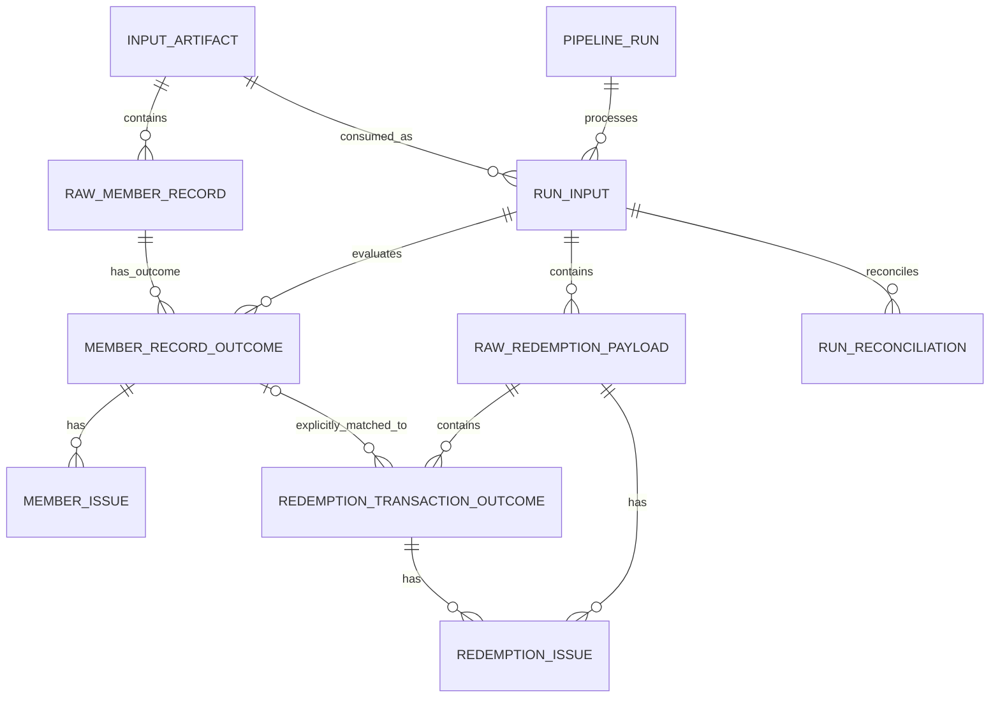

# Milestone 5A — DuckDB relational schema proposal

**Document status: Proposed — pending review**

## Change summary

- Replaced the multi-layer member and redemption persistence proposal with a smaller model: immutable raw records, one per-run outcome relation per pipeline, issue relations, input/run lineage, reconciliation, and filtered curated views.
- Added the exact assessment field contract and separated assessment facts from engineering decisions and unresolved assumptions.
- Defined artifact, content-hash, and run identities; added redemption-to-artifact lineage and artifact-level reconciliation.
- Removed per-record observation, member-link, and optional source-file BLOB archival tables.
- Added synthetic-only latest-record-wins scenarios and made the current-source limitations explicit.
- Clarified that local DuckDB views map to physical Snowflake country target tables and a flattened redemption output.
- Specified the filename/timestamp convention and enumerated the Snowflake DDL deliverables with field mappings.

This is a design proposal only. The original assessment PDF and [assessment requirements transcription](assessment-requirements.md) remain the business specification. Local CSV/XLSX files and current Python code are evidence about the demonstration inputs and implementation interfaces; they do not replace the assessment contract.

## 1. Specification categories and assessment contract

Labels distinguish assessment facts from implementation choices and unresolved matters:

- **[A] Assessment-specified:** Stated in the PDF, including its field table and illustrative examples.
- **[E] Engineering decision:** Needed to implement persistence, provenance, queryability, or repeatable processing.
- **[U] Assumption or unresolved:** Not established by the PDF or supplied files; requires explicit confirmation or remains a limitation.

The following member-field contract was checked against the field-specification table in `reference/assessment.pdf`. The PDF's illustrative header/detail, intermediate table, and supplied sample files do not all contain the same fields; the table below is the field specification, not a claim that every source provides every field.

| Position | Assessment field | Length | Assessment type | Mandatory | Assessment key |
|---:|---|---:|---|:---:|:---:|
| 1 | Member Name | 255 | VARCHAR | Yes | Yes |
| 2 | Member ID | 18 | VARCHAR | Yes | No |
| 3 | Enrollment Date | 8 | DATE | Yes | No |
| 4 | Last Flight Date | 8 | DATE | No | No |
| 5 | Tier Code | 5 | CHAR | No | No |
| 6 | Agent Name | 255 | CHAR | No | No |
| 7 | State | 5 | CHAR | No | No |
| 8 | Country | 5 | CHAR | No | No |
| 9 | Post Code | 5 | INT | No | No |
| 10 | Date of Birth | 8 | DATE | No | No |
| 11 | Active Member | 1 | CHAR | No | No |

**[A] Other explicit assessment requirements:**

- The source system sends a daily member flat file and a semi-structured JSON redemption feed; the production design is asked to account for billions of records per day. This is not a throughput result from the local sample.
- Create Snowflake raw/landing, staging, and country-specific target table queries.
- Derive `Age` from DOB and `Stale_Member` when the days since flight are strictly greater than 90.
- Distribute records to country-specific tables. When a member moves countries, latest-record-wins applies.
- Flatten nested redemption data to one queryable row per transaction and explain how it joins back to member profiles.
- Validate mandatory fields, key uniqueness, and anomalies visible in examples.

The PDF's illustrative JSON fields are parent `member_id`, `feed_date`, and child `txn_id`, `txn_date`, `partner`, `miles_redeemed`, and `status`. The example does not declare `txn_id` as a key or state a uniqueness guarantee.

### Unresolved assessment/data limitations

- **[U] Member Name key scope:** The PDF marks Member Name as a key but does not define whether uniqueness applies within a file, country, or complete feed. The existing implementation assumes one source-country dataset/batch is the scope and quarantines all rows in a duplicate-name group within that batch. This is provisional, not assessment-confirmed. Same names in different country datasets are not compared, merged, or quarantined by name.
- **[U] Member identity and recency:** Current inputs contain repeated source-local IDs and no confirmed global member ID or source business-update/effective timestamp. Do not treat names, source IDs, filenames, feed dates, file arrival, or ingestion timestamps as global identity or business recency.
- **[U] Latest-record-wins:** This is an explicit assessment requirement, but cannot be demonstrated as a real-data outcome with the current sources. A production implementation requires a confirmed stable identity and business ordering field. The algorithm must be exercised with clearly synthetic-only fixtures until those fields are available.
- **[U] Transaction uniqueness:** Existing duplicate detection applies within one `process_redemption_payloads` invocation. No cross-run uniqueness is guaranteed or represented in the database.
- **[U] Local country routing:** The three local filename mappings are demo-only provenance; the supplied files do not contain a row-level country field. They do not prove a member's country.
- **[U] Source differences:** Supplied local CSV/XLSX schemas differ from the PDF's illustrative pipe-delimited layout. Some fields are absent, renamed, or source-specific; Post Code is in the field table but absent from the illustrative header/detail and intermediate layout. Preserve source values and column-presence metadata rather than filling gaps by assumption.
- **[U] Redemption contract:** `YYYYMMDD` and required JSON fields are taken from the illustrative payload; the PDF does not establish a production JSON contract or complete partner/status domains.

## 2. Minimum viable entity relationship

`artifact_id` identifies one source artifact/content instance; `content_sha256` verifies the exact source bytes (or a documented canonical representation for in-memory JSON inputs). `run_id` identifies one execution. These identities have separate purposes and neither is a business key.



The `members_aus`, `members_ind`, and `members_usa` DuckDB views select non-quarantined member outcomes by demo route. A `curated_redemptions` view selects non-quarantined transaction outcomes. Snowflake deliverables must map these local query outputs to the physical country-specific tables and flattened transaction table required by the assessment.

## 3. Tables and column-level design

### Run and input lineage

| Table | Columns, keys, and purpose |
|---|---|
| `pipeline_run` | **[E]** `run_id` primary key, generated uniquely per execution; `started_at_utc`, `finished_at_utc`, `status`, explicit `as_of_date`, and nullable `reprocess_of_run_id` self-reference. A retry may reuse a run ID transactionally; an intentional reprocess gets a new run ID. |
| `input_artifact` | **[E]** `artifact_id` primary key; `source_kind`, source name/code, `content_sha256`, and a schema manifest containing ordered columns and per-sheet schema fingerprints. Define `artifact_id` exactly as `"{source_kind}-{source_identity.lower()}-{sha256(UTF8(source_identity + NUL + content_sha256))}"`; `source_identity` is the existing member `source_code` for member files and the configured feed/source name for redemptions. This mirrors the existing member batch-ID derivation, but persists no redundant `batch_id` column. For file inputs, `content_sha256` verifies exact file bytes. For in-memory redemption inputs without source bytes, implementation uses an ordered payload collection with recursive type tags: mapping key order is canonicalized, and nested None, bool, int, finite float, string, bytes, date, datetime, mapping, list and tuple values have distinct representations. Text identity is UTF-8 text; bytes identity is raw bytes, so they differ even when content looks equivalent. Unsupported values, cycles and non-finite floats fail explicitly. Such a canonical hash is not evidence of producer-file bytes. |
| `run_input` | **[E]** Composite primary key `(run_id, artifact_id)`; foreign keys to run and artifact; per-execution `original_filename`, nullable producer-declared `feed_generated_at_utc`, `ingested_at_utc`, `input_status`, and failure detail. Both timestamps use timezone-aware UTC values; generation time remains NULL unless supplied/verified by the producer. This row records each execution/replay while allowing a changed filename to be recorded without changing content identity. Neither timestamp is business recency. |

### Filename and date/time specification

**[A] Assessment request:** The PDF asks the design document to specify the filename string and extension and a date/time format. It gives `YYYYMMDD` and `HHMMSSTT` as examples, or permits another format. It does not define a required filename pattern, the meaning of `TT`, a timezone, or whether the filename time means extraction time. The requirements transcription records the same ambiguity.

**[E] Proposed convention (not prescribed by the assessment):**

```text
<feed>_<source>_<feed-generated-at-utc>_<sha256-prefix>.<extension>
```

`feed-generated-at-utc` uses `YYYYMMDDTHHMMSSZ` (UTC, whole seconds, literal `T` separator and `Z` suffix); `sha256-prefix` is the first 12 lowercase hexadecimal characters of the full content SHA-256. Examples of the pattern are `member_AUS_20261124T153000Z_a1b2c3d4e5f6.xlsx` and `redemption_<approved-feed-id>_20261124T153000Z_a1b2c3d4e5f6.json`. The example timestamp is illustrative only. The source/feed identifier must come from an approved source manifest; local `AUS`, `IND`, and `USA` names are adapter labels and do not establish member country.

| Input | Existing local extension / unchanged input | Proposed production extension |
|---|---|---|
| AUS member sample | `AUS.xlsx` / `.xlsx` | `.dat` for the assessment's pipe-delimited flat file |
| IND member sample | `IND.csv` / `.csv` | `.dat` for the assessment's pipe-delimited flat file |
| USA member sample | `USA.csv` / `.csv` | `.dat` for the assessment's pipe-delimited flat file |
| Redemption feed | No supplied production file; PDF JSON is illustrative only | `.json` |

The production `.dat` and `.json` extensions are **engineering proposals**, not assessment requirements; confirm them with the source owner. Do not rename the three local files. The assessment's `YYYYMMDD` dates in member/JSON examples are data-field formats and are not a specification for the filename timestamp. The JSON `feed_date` is retained as the example's date-only value; it is not a time or timezone.

Timestamp semantics are deliberately separate:

- **Feed-generation timestamp:** The proposed filename timestamp means producer-declared time when the complete feed artifact was generated/closed, in UTC. This meaning and availability require source-owner confirmation. It is operational file metadata, not a member business update time.
- **Business-effective/update timestamp:** No such field is specified in the PDF field table or present in the supplied member sources. It must not be inferred from filename time, `feed_date`, file arrival, or ingestion time. Latest-record-wins requires a separately confirmed source business timestamp (and source-defined tie-breaker if needed).
- **Ingestion timestamp:** `run_input.ingested_at_utc` records when this application ingested the artifact, as a timezone-aware UTC timestamp. It is created by the ingestion execution and is never used as business recency.

The literal `HHMMSSTT` example is not adopted because `TT` is undefined. `YYYYMMDDTHHMMSSZ` is the proposed unambiguous replacement and remains an engineering decision.

**Source retention:** Original member source files remain in the repository/demo input location. DuckDB persists the original filename, SHA-256, source and row provenance, schema manifest, and raw row values. No source-file BLOB archival is proposed. Changes to originals remain detectable by comparing hashes.

### Raw member records and outcomes

| Table | Columns, keys, and purpose |
|---|---|
| `raw_member_record` | **[E]** `raw_record_id` internal primary key; `artifact_id` foreign key; `source_code`, nullable `sheet_name`, non-null `sheet_name_key` (empty string for a non-workbook source), one-based `source_row_number`, `schema_fingerprint`, and `raw_values` JSON. Add `UNIQUE (artifact_id, raw_record_id)` for composite references and `UNIQUE (artifact_id, source_code, sheet_name_key, source_row_number)` so one source coordinate cannot be loaded twice into the same artifact. `raw_record_id` is an internal storage locator derived from artifact and row coordinates, never a member identity. Original filename is obtained from `run_input` for the execution. |
| `member_record_outcome` | **[E]** Columns `run_id`, `artifact_id`, and `raw_record_id`; primary key `(run_id, raw_record_id)`; composite foreign key `(run_id, artifact_id)` to `run_input`; composite foreign key `(artifact_id, raw_record_id)` to `raw_member_record`. Contains the typed/parsed assessment fields below, derived values, `disposition`, and local route provenance. There is one outcome for every input row per run, including quarantined rows; raw source values remain separately preserved. |
| `member_issue` | **[E]** Composite primary key `(run_id, raw_record_id, issue_ordinal)`; foreign key to the outcome; `issue_category` (validation/transformation/routing), `rule_code`, severity, nullable field name, and detail. The referenced raw record supplies the original values and provenance. |

`member_record_outcome` carries one canonical column for each assessment field; `source_member_id` is the source-local representation of assessment `Member ID`, not a new identity. The PDF's length is a field-width specification; for Member ID, it does not mean every value must contain exactly 18 characters. For a field absent from a source schema, the typed value is NULL and absence is established by the artifact's schema manifest. A present field whose source value is NULL/blank retains its original value in `raw_values` and has a corresponding presence entry in the schema manifest.

For the local duplicate-name rule, use `(run_id, artifact_id, member_name)` as the assumed source-country batch scope. Keep all duplicate rows in raw/outcome/issue relations and quarantine every row in the duplicate group. Do not put a global unique constraint on the raw or outcome relation because it would prevent retaining duplicates. The curated view invariant is that no `(run_id, artifact_id, member_name)` has more than one visible row; validation and tests must enforce that invariant. This scope remains provisional pending source-owner confirmation.

| Outcome column | Assessment definition | Persistence and validation meaning |
|---|---|---|
| `member_name` | **[A]** `VARCHAR(255)`, mandatory, key | Retain raw value separately; null/invalid mandatory values quarantine. Duplicate-name scope remains the provisional assumption stated above. |
| `source_member_id` | **[A]** `VARCHAR(18)`, mandatory, not key | Preserve as text; validate mandatory status and maximum specified length. Not globally unique. |
| `enrollment_date` | **[A]** `DATE`, length 8, mandatory | Parsed nullable date plus raw source value; invalid/missing mandatory value quarantines. |
| `last_flight_date` | **[A]** `DATE`, length 8, optional | Nullable parsed date plus raw value. |
| `tier_code` | **[A]** `CHAR(5)`, optional | Nullable typed/string value; no unsupported domain mapping. |
| `agent_name` | **[A]** `CHAR(255)`, optional | Nullable string value. |
| `state` | **[A]** `CHAR(5)`, optional | Nullable string value. |
| `country` | **[A]** `CHAR(5)`, optional | Nullable source field; do not fill from filename. |
| `post_code` | **[A]** `INT`, length 5, optional | Nullable parsed integer plus original lexical value in raw data; the source field's zero-padding semantics remain unresolved. |
| `dob` | **[A]** `DATE`, length 8, optional | Nullable parsed date plus raw value. |
| `active_member` | **[A]** `CHAR(1)`, optional | Nullable string; do not invent a full allowed-value domain. |
| `age` | **[A]** Derived from DOB; assessment does not define the Feb. 29 convention | Nullable integer computed using the run's explicit `as_of_date`; the current March 1 convention for non-leap years is an implementation assumption. |
| `stale_member` | **[A]** True when days since Last Flight Date are strictly greater than 90 | Nullable Boolean; exactly 90 days is false. Use explicit run `as_of_date`; missing/invalid flight date yields NULL under the approved implementation behavior. |
| `routed_country_code`, `routing_method` | **[E/U]** Local routing metadata, not assessment source fields | Only the three documented filename mappings; method `FILENAME_SAMPLE_ADAPTER`. Keep distinct from source `country`. |
| `disposition` | **[E]** accepted/warning/quarantined | Quarantine records remain in this outcome and raw table but are excluded from curated views. |

The PDF's length/type fields are preserved as source-contract metadata; they do not imply all local sources contain these columns. Source-specific extras such as IND's member-type attribute remain in `raw_values` and are not promoted to canonical fields without an approved mapping.

### Raw redemption payloads and transaction outcomes

| Table | Columns, keys, and purpose |
|---|---|
| `raw_redemption_payload` | **[E]** Composite primary key `(run_id, artifact_id, payload_index)`; composite foreign key `(run_id, artifact_id)` to `run_input`. Retain one-based payload index, `payload_representation` (`text`, `bytes_hex`, or `mapping_json`), and exactly one corresponding nullable raw column: `raw_payload_text VARCHAR`, `raw_payload_hex VARCHAR` (lossless hexadecimal encoding of input bytes), or `raw_payload_json JSON`. Also retain raw parent fields where available, parsed `feed_date` when valid, and parent disposition. A CHECK requires exactly one raw representation; parent issues are in `redemption_issue`. Every supplied parent has a row, including malformed syntax and missing/invalid `redemptions`. |
| `redemption_transaction_outcome` | **[A/E]** Composite primary key `(run_id, artifact_id, payload_index, transaction_index)`; foreign key to its raw parent. One row per element of a valid redemptions array, including malformed children. Store `txn_id`, raw and parsed `txn_date`, `partner`, raw/typed miles, `status`, child raw JSON, disposition, and `matched_member_run_id` plus `matched_member_raw_record_id`, both nullable. Parent `member_id`/`feed_date` are exposed in the curated view through the parent FK rather than copied. `txn_id` has no global unique constraint. |
| `redemption_issue` | **[E]** Internal `issue_id` primary key; required parent locator `(run_id, artifact_id, payload_index)` FK; nullable transaction locator `(run_id, artifact_id, payload_index, transaction_index)` composite FK; issue category, rule code, severity, field name, and detail. Parent issues have no child locator; transaction issues have a complete child locator. |

The nullable member-reference pair uses `CHECK ((matched_member_run_id IS NULL AND matched_member_raw_record_id IS NULL) OR (matched_member_run_id IS NOT NULL AND matched_member_raw_record_id IS NOT NULL))` and a composite foreign key to the declared primary key `member_record_outcome(run_id, raw_record_id)`. This avoids a partial FK where one half of the reference could be NULL. A non-NULL pair represents an explicitly confirmed association to that exact stored member outcome; persistence rejects a match to a quarantined outcome. No match is inferred from names or source-local IDs. The persistence API accepts an explicit mapping from the current Python `matched_member_key` string to a confirmed record locator; without that mapping, both FK columns remain NULL and an unmatched issue is retained.

Duplicate transaction IDs are checked within one `process_redemption_payloads` invocation and every matching transaction is quarantined. Separate invocations are not compared, even if they share a run ID. The database key is the run/artifact/payload/child position, not `txn_id`; the same ID in a later independent run is not automatically a duplicate.

## 4. Curated outputs and assessment delivery mapping

- **DuckDB `members_aus`, `members_ind`, `members_usa` views:** Select `member_record_outcome` rows whose disposition is not quarantined and whose demo `routed_country_code` is the corresponding code. Retain source field `country` separately; the views identify sample routing only.
- **DuckDB `curated_redemptions` view:** Joins each non-quarantined `redemption_transaction_outcome` to its raw parent to expose parent `member_id`/`feed_date`, transaction fields, and provenance. Warning/unmatched transactions remain queryable; quarantined transactions remain in the outcome and issue tables only.
- **Snowflake physical targets:** The view projections map to the assessment's required physical country-specific member tables. Snowflake DDL must also define raw/landing and staging structures and a physical flattened redemption table. The local views are not a substitute for those Snowflake deliverables.
- **Latest-record-wins:** A current canonical member target and country-table synchronization need a confirmed stable member identity and source business update/effective timestamp. With those contract fields confirmed, use a deterministic window ordering such as `ROW_NUMBER() OVER (PARTITION BY confirmed_member_key ORDER BY source_updated_at DESC, source_defined_sequence DESC)` only if the source defines a tie-break sequence. Remove the old country copy and upsert the new one atomically. Do not use ingestion timestamp as business recency. If order values are tied/conflicting or missing, retain raw/audit rows and hold the current-state update for review.
- **Member join:** The example's `member_id` and illustrative `Member ID` values align, but the PDF does not define the operational identity scope and marks Member ID as not a key. A production join must validate that the source's member-ID scope resolves unambiguously. The local source IDs do not match the illustrative redemption ID; retain unmatched transactions. Synthetic successful joins must be labeled synthetic and use an explicit mapping to a particular persisted member record.

## 5. Batch processing, idempotency, and reconciliation

### Identity and reruns

1. `content_sha256` is SHA-256 of exact file bytes for file inputs. `artifact_id` is a stable identifier derived from source kind/identity and content hash; it identifies content in source context and is not a run or business ID. Do not also persist the old `batch_id` as a second identity.
2. `run_id` is generated uniquely per execution and is never derived from a file hash. `run_input` links the execution to every artifact and retains per-input ingestion time/status.
3. Raw member rows are idempotent per artifact and source coordinate. Validation/transformation outcomes are keyed by `(run_id, raw_record_id)`; redemption parent/child outcomes are keyed by run, artifact, and source array positions.
4. Retrying the same run ID uses a transaction and repeatable keys, so it does not duplicate rows. An intentional reprocess uses a new run ID, optionally referencing the prior run; history is retained.
5. JSON file artifacts use the original file-byte hash. If the API receives a string, bytes, or Python mapping rather than a file, define the canonical hash input and store the representation type. The supplied caller `batch_id` is provenance only if retained as an external label; it is never a substitute for artifact identity.
6. Persist one artifact/scope reconciliation row per run input. Record failed input/run status without publishing a partial curated result. Database writes for a run should be transactional.

### Reconciliation table

`run_reconciliation` has primary key `(run_id, artifact_id, scope)` and foreign key `(run_id, artifact_id)` to `run_input`. `scope` is one of `member_record`, `redemption_parent`, or `redemption_transaction`. Columns are `read_count`, `accepted_count`, `warned_count`, `quarantined_count`, `transformed_count`, `unmatched_count`, `raw_persisted_count`, and `curated_persisted_count`, all non-negative integers.

- `read_count`: Number of input units at the named scope: member source rows, parent payloads, or child transaction array elements. These scopes are separate and must not be added together as if they were a single record count.
- `accepted_count`, `warned_count`, `quarantined_count`: Mutually exclusive final dispositions for those input units. For each scope their sum equals `read_count`. For transaction scope, parent-invalid children are quarantined; unmatched-reference warnings can coexist with another issue, but the final disposition remains a single category.
- `transformed_count`: Number of input units for which derived/member transformation or child flattening was actually attempted and produced its corresponding outcome. For members, quarantined rows are excluded because the current transformation API skips them; non-quarantined rows count even when nullable derived values result from missing/invalid optional dates. Every child in a valid `redemptions` array with an outcome is counted, even if malformed. Parent payloads are not flattened and have zero transformed count.
- `unmatched_count`: Number of redemption transaction outcomes with a `MEMBER_REFERENCE_UNMATCHED` issue. It is a subset measure; it can overlap warning or quarantine counts. It is zero for member and parent scopes.
- `raw_persisted_count`: Number of input units whose raw representation is persisted for that artifact and scope: raw member rows, raw parent payloads, or raw child values retained on transaction outcomes. It includes quarantined inputs. For a repeated member artifact, count raw rows available in the raw table, even when they were stored by an earlier run.
- `curated_persisted_count`: Number of non-quarantined outcome rows exposed by the corresponding curated view for this run/artifact/scope. It is zero for the parent scope, since parent payloads are audit/landing records, not curated outputs.

Also reconcile parent-child cardinality: the sum of parent `transaction_count` for valid arrays equals transaction `read_count`; every supplied payload has one parent row, including malformed payloads. An absent or invalid array produces no child count, but its parent remains accounted for.

## 6. DuckDB and Snowflake implementation differences

DuckDB is the local executable model. Use explicit `DATE`, `TIMESTAMP WITH TIME ZONE`/UTC convention, `BOOLEAN`, integer, `VARCHAR`, `JSON`, and composite primary/foreign keys as appropriate. DuckDB enforces primary, unique, and foreign-key constraints; constraints have load/update costs, so define only those needed for source coordinates, run locators, and confirmed references. [DuckDB constraint documentation](https://duckdb.org/docs/current/sql/constraints).

Snowflake deliverables should use `VARIANT` for raw nested JSON and `FLATTEN` to produce one physical row per redemption. Use bulk landing, set-based SQL, `MERGE`/window logic for incremental processing, and physical country target tables. On standard Snowflake tables, primary/unique/foreign-key constraints are informational rather than enforced (while `NOT NULL` and `CHECK` are enforced), so validation and deterministic load logic must uphold those invariants. [Snowflake constraint documentation](https://docs.snowflake.com/en/sql-reference/constraints-overview).

The country views and flattened redemption view are local query interfaces; their selected columns and filters map to Snowflake's physical country-specific member targets and flattened transaction target. Production volume requires bulk loading, parallel warehouse processing, incremental set-based transformations, and measured workload sizing. No local sample benchmark is claimed.

## 7. Required Snowflake DDL deliverables

The assessment explicitly requires Snowflake table queries for raw/landing, staging, and country-specific targets. This document specifies their design; executable SQL is a separate deliverable in the SQL implementation milestone. The intended artifacts follow the approved traceability plan:

| Planned SQL artifact | Required definitions and role |
|---|---|
| `sql/001_raw_landing.sql` | Run/input artifact metadata, including nullable producer-declared `FEED_GENERATED_AT_UTC TIMESTAMP_TZ` and `INGESTED_AT_UTC TIMESTAMP_TZ` normalized to UTC; raw member landing that retains each delimited source record and source provenance; raw redemption landing with raw payload text plus parsed `VARIANT` where valid. Landing keys are technical artifact/row or artifact/payload locators, not member or transaction business keys. |
| `sql/002_staging.sql` | Typed member candidate staging with the assessment fields and derived `Age`/`Stale_Member`; retain disposition and source lineage. Invalid mandatory values remain represented for issue/quarantine handling, so candidate staging columns are nullable. |
| `sql/003_country_targets.sql` | Physical country-specific member target tables with assessment fields and derived attributes. The target-country allowlist is source-owner/configuration controlled; local filenames do not define production target countries. |
| `sql/004_transform_members.sql` | Set-based member validation/derivation, latest-record-wins prerequisites, and controlled distribution/synchronization into physical country targets. Latest selection uses only confirmed business identity/order fields; current supplied data cannot drive it. |
| `sql/005_transform_redemptions.sql` | Flattened physical redemption output and transformation using Snowflake `VARIANT`/`FLATTEN`, retaining parent fields and source lineage; unmatched member references remain represented and reported. |
| `sql/006_data_quality.sql` | Issue/quarantine and artifact/run reconciliation structures and queries, including counts for raw, accepted, warned, quarantined, transformed, unmatched, and persisted outputs. |

### Assessment field mapping to Snowflake

The PDF contract below is authoritative. `DATE` length 8 describes the source representation; Snowflake `DATE` has no character width, so the raw landing retains the original eight-character value alongside the typed date. The optional `Post Code` contract maps to `NUMBER(5,0)` to retain the five-digit numeric precision; raw landing preserves its original lexical value and any leading zeroes.

| Assessment field | Snowflake staging candidate | Country-target column | Mandatory / key handling |
|---|---|---|---|
| Member Name | `VARCHAR(255) NULL` | `VARCHAR(255) NOT NULL` | Assessment: mandatory, key Yes. Preserve duplicates in raw/staging; under the provisional source-country batch assumption, quarantine every duplicate group before curated publication. A physical target primary-key declaration on `MEMBER_NAME` follows the PDF's key flag only if its scope is confirmed; Snowflake standard-table PKs are informational. |
| Member ID | `VARCHAR(18) NULL` | `VARCHAR(18) NOT NULL` | Assessment: mandatory, key No. No PK/unique constraint; never infer global identity. |
| Enrollment Date | `DATE NULL` | `DATE NOT NULL` | Assessment: mandatory, key No. Preserve raw eight-character source value in landing; invalid/missing values are issued/quarantined before target load. |
| Last Flight Date | `DATE NULL` | `DATE NULL` | Assessment: optional, key No. |
| Tier Code | `CHAR(5) NULL` | `CHAR(5) NULL` | Assessment: optional, key No. |
| Agent Name | `CHAR(255) NULL` | `CHAR(255) NULL` | Assessment: optional, key No. |
| State | `CHAR(5) NULL` | `CHAR(5) NULL` | Assessment: optional, key No. |
| Country | `CHAR(5) NULL` | `CHAR(5) NULL` | Assessment: optional, key No. Do not substitute filename routing for this field. |
| Post Code | `NUMBER(5,0) NULL` | `NUMBER(5,0) NULL` | Assessment: optional, key No; Snowflake precision mapping for PDF `INT`, length 5. Raw lexical form remains in landing. |
| Date of Birth | `DATE NULL` | `DATE NULL` | Assessment: optional, key No. Preserve raw eight-character value in landing. |
| Active Member | `CHAR(1) NULL` | `CHAR(1) NULL` | Assessment: optional, key No. |

The staging nullability above is an **engineering decision** to keep invalid and missing source values queryable with their issues. The validated country target has `NOT NULL` for the three assessment-mandatory fields. It has no member-ID key. The PDF marks Member Name as a key, but does not scope that key; therefore the target key declaration is explicitly conditional on source-owner confirmation. Until then, apply the approved provisional batch-scoped duplicate check and do not claim a globally unique name key.

`Age` is a derived integer column; `Stale_Member` is a derived Boolean. They are not rows in the PDF field table and use the explicit `as_of_date`. For redemption landing, `VARIANT` stores successfully parsed JSON and `VARCHAR` preserves original text for malformed payloads. `FLATTEN` applies to `redemptions` array elements and produces one row per transaction; `txn_id` is not declared unique absent a source guarantee.

The PDF gives the following redemption fields in an **illustrative JSON payload**, not a fully specified production schema. The Snowflake types below are **engineering mappings** from the example; the PDF gives no lengths, key flags, or separate production nullability contract for them.

| JSON field | Snowflake flattened output mapping | Nullability/key decision |
|---|---|---|
| Parent `member_id` | `VARCHAR` | Nullable in landing/flattened staging when malformed or absent; retain unmatched values. No global identity or key declaration. |
| Parent `feed_date` | Raw `VARCHAR` plus parsed `DATE` | Nullable parsed date when absent/invalid; example representation is `YYYYMMDD`; no time/timezone implied. |
| Child `txn_id` | `VARCHAR` | Nullable in staging when malformed/absent; no primary/unique constraint because the assessment specifies no uniqueness guarantee. |
| Child `txn_date` | Raw `VARCHAR` plus parsed `DATE` | Nullable parsed date when malformed/absent; example representation is `YYYYMMDD`. |
| Child `partner` | `VARCHAR` | Nullable in staging when malformed/absent; preserve values without inventing a domain. |
| Child `miles_redeemed` | `NUMBER(38,0)` | Nullable in staging when malformed/absent; values that are not integers remain represented in raw payload and are issued. No range or sign rule is assessment-specified. |
| Child `status` | `VARCHAR` | Nullable in staging when malformed/absent; preserve values without inventing a complete status domain. |

For a validated flattened output, the example's required fields are expected to be present, but that expectation remains tied to the illustrative feed shape until the production JSON contract is confirmed. Invalid/malformed payloads and child elements remain in raw/issue relations rather than being rejected by landing-table `NOT NULL` constraints.

## 8. Mapping from current Python objects

| Current object | Relational destination |
|---|---|
| `IngestionBatch` | `input_artifact` plus `run_input`; its `batch_id` maps to/derives `artifact_id`, while `source_sha256` remains the content digest. Its schema tuple becomes the artifact schema manifest. |
| `RawRecord` | `raw_member_record`; file name, source/sheet/row, schema fingerprint, hash, and raw values persist. `ingested_at_utc` is recorded once on `run_input` because current ingestion gives all rows in a batch the same time. |
| `ValidationResult` / `RecordOutcome` | `member_record_outcome.disposition` and canonical/typed fields. |
| `ValidationIssue` | `member_issue`. |
| `TransformationResult` / `CuratedRecord` | Derived columns and route provenance on `member_record_outcome`; transformation/routing findings in `member_issue`; country views filter quarantined records. |
| `RedemptionPayloadOutcome` | `raw_redemption_payload`, including parent status and raw values. |
| `FlattenedRedemption` / `RedemptionOutcome` | `redemption_transaction_outcome`; the curated view filters quarantined outcomes and joins the parent. |
| `RedemptionIssue` | `redemption_issue`. |
| Reconciliation results | `run_reconciliation`, one artifact/scope row. |

The current redemption API returns `matched_member_key: str | None`; the relational FK requires confirmed `(run_id, raw_record_id)` values. `persist_redemption_results` accepts an explicitly supplied mapping and only persists a match if it resolves to one non-quarantined member outcome. Otherwise it stores no FK and retains or adds the unmatched issue.

## 9. Persistence API boundary

Current ingestion, validation, transformation, and redemption functions remain in-memory and persistence-agnostic. The focused connection-taking `persistence.py` exposes:

- `initialize_schema(connection)` and `open_database(path_or_connection)`
- `create_pipeline_run(connection, run_id, as_of_date=..., ...)` and `finish_pipeline_run(connection, run_id, status=..., ...)`
- `register_input_artifact(...)` for explicit pending artifact/run association
- `persist_member_results(connection, run_id, batch, validation_result, transformation_result, ...)`
- `persist_redemption_results(connection, run_id, result, ..., source_bytes=..., confirmed_member_references=...)`

Member persistence checks batch/result consistency and matching explicit `as_of_date`; it derives the artifact identity from the source code and file SHA-256. Redemption persistence binds every payload to the registered run/artifact. Exact redemption artifact bytes are hashed when `source_bytes` is supplied; otherwise a deterministic recursively type-tagged representation of the in-memory payload collection is hashed. Mapping payloads persisted in `raw_payload_json` use a versioned `typed-json-v1` envelope to retain nested Python types. A succeeded-input retry verifies expected raw locators, outcomes, issues and database-derived reconciliation before returning; inconsistency raises `PersistenceIntegrityError`. Each artifact write is transactional and retry-safe for a complete succeeded input. Intentional reprocessing uses a new run ID. The APIs do not yet provide full-run orchestration or a CLI.

## 10. Test plan

1. **Schema and keys:** Initialize a fresh DuckDB database; inspect types, primary/foreign keys, source-coordinate uniqueness, nullable confirmed-member composite FK behavior, and required-null-pair check.
2. **Assessment contract:** Assert each member column's specified type, length, mandatory/key metadata in schema documentation/mapping; verify local absence versus present NULL using the source schema manifest and raw values.
3. **Raw lineage:** Persist all three supplied file batches; verify hash, artifact identity, file/sheet/row provenance, raw values, and per-run UTC ingestion metadata. Confirm originals remain unchanged.
4. **Validation and quarantine:** One outcome per raw member row; issues link to provenance; duplicate Member Name groups within one assumed source-country batch quarantine all group rows; same names across separate source artifacts do not interact; no quarantined rows appear in country views.
5. **Derived fields:** Explicit `as_of_date`; birthday boundaries; documented Feb. 29 assumption; stale at 89/90/91 days; missing and invalid DOB/flight behavior.
6. **Country output:** Only three demo filename routes; route provenance is `FILENAME_SAMPLE_ADAPTER`; source `country` remains distinct; unknown routes do not enter country views.
7. **Redemption lineage/flattening:** Every input parent, including malformed JSON and missing/invalid arrays, has a parent outcome linked by FK to its run/artifact. Each child array element has an outcome and raw child retained. Parent fields remain available through the curated join.
8. **Redemption issues and member reference:** Verify duplicate transaction IDs all quarantine within one invocation; separate invocations, including invocations in the same run, are not compared. Invalid dates/miles and unmatched references remain queryable. A successful join uses an explicit synthetic mapping to one persisted non-quarantined member row; incorrect/null-pair FK combinations fail.
9. **Synthetic-only latest-record-wins:** In a test-only fixture/relation separate from production source rows, use clearly synthetic global identifiers, countries, and source update timestamps. Cover (a) a member moving countries and removal from old/addition to new target, (b) a late-arriving record with an older business timestamp losing to the newer record, (c) equal timestamps with identical and conflicting values held from current-state publication unless a source-defined tie-breaker exists, and (d) missing identity or ordering values held from current-state publication. Never represent these synthetic fields as observed in supplied files or add them to the real-source schema by assumption.
10. **Idempotency and history:** Same run/artifact retry creates no duplicate raw/outcome/reconciliation rows; intentional replay with a new run ID retains both run histories; changed bytes produce a different content hash/artifact identity.
11. **Reconciliation:** For every artifact and scope, accepted + warned + quarantined = read; transformed/raw-persisted/curated-persisted counts match actual relations/views; unmatched count matches unmatched issue rows; parent-child counts reconcile.

## 11. Remaining assumptions and limitations

- Member Name uniqueness within one source-country batch is provisional and requires source-owner confirmation; the PDF does not define the scope.
- The PDF explicitly requests latest-record-wins, but actual source rows lack a confirmed global identity and business update/effective timestamp. Only synthetic tests can exercise that behavior until source fields and ordering/tie policy are supplied.
- Member ID is mandatory but not an assessment key. Duplicate local IDs cannot be used to infer global identity or an unambiguous redemption join.
- `txn_id` is not declared unique by the PDF. The implementation only detects duplicate IDs within one processing invocation/run; no global or cross-run guarantee is made.
- Local country routing is filename-based demo provenance and is not member-country truth.
- JSON date/required-field expectations follow the illustrative example, not a confirmed production feed contract.
- February 29 birthday handling on March 1 in non-leap years is an implementation assumption, not an assessment rule.
- Post Code is specified as an optional five-length INT, but the source layout and leading-zero semantics are inconsistent/unresolved. Raw lexical values must be retained.
- In-memory redemption artifact hashes use deterministic recursive type-tagged canonicalization, with key-order independence and explicit rejection of unsupported values. Exact source-byte identity is available only when the caller supplies original bytes. Mapping payloads are persisted with a `typed-json-v1` envelope. The explicit `matched_member_key` to `(run_id, raw_record_id)` mapping is caller-supplied and tested using a synthetic-only member fixture; the illustrative PDF ID is not linked to any supplied member record, and no cross-source identity resolution is inferred.
